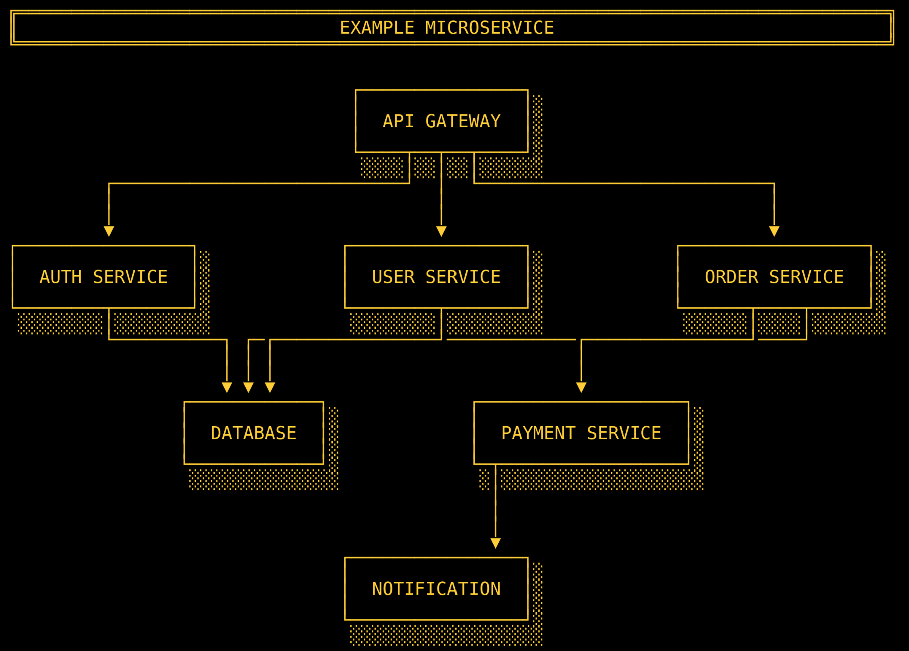
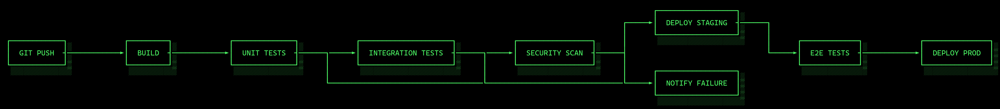

# RetroFlow

```
 ___________________________________________________________
|                                                           |
|   _____      _             ______ _                       |
|  |  __ \    | |           |  ____| |                      |
|  | |__) |___| |_ _ __ ___ | |__  | | _____      __        |
|  |  _  // _ \ __| '__/ _ \|  __| | |/ _ \ \ /\ / /        |
|  | | \ \  __/ |_| | | (_) | |    | | (_) \ V  V /         |
|  |_|  \_\___|\__|_|  \___/|_|    |_|\___/ \_/\_/          |
|                                                           |
|            [ Beautiful ASCII Flowcharts ]                 |
|___________________________________________________________|
               ||                           ||
```

A Python library for generating beautiful ASCII and PNG flowcharts from simple text descriptions.

[](https://badge.fury.io/py/retroflow)
[](https://pypi.org/project/retroflow/)
[](https://opensource.org/licenses/MIT)
[](https://codecov.io/gh/ronikobrosly/retroflow)


## Overview 

This is a project to help engineers, researchers, project managers, and others create beautiful, retro-looking ASCII flow diagrams. ASCII diagrams are pretty, and harken back to the mid-20th century technical documentation. They also have real advantages:

1) They work wonderfully in the age of agentic AI, which can easily read and parse these small representations.
2) ASCII diagrams can live inline with: PRs, Markdown files, Slack threads, etc.
3) ASCII diagrams optimize for thinking speed, not presentation quality. It encourages iteration and deletion instead of premature refinement.
4) Minimalist diagrams reduce visual noise (although they do still look retro and pretty)
5) They're tool agnostic and can be rendered anywhere


```
                                       ╔════════╗
                                       ║  Mesh  ║
                                       ╚════════╝


    ┌────────────────────────────────────────────────────────────────────────────┐
    │                                                                            │
    │ ┌──────────────────────┐                                                   │
    │ │                      │             ┌──────────┐                          │
    │ │                      │ ┌───────────┘          │                          │
    │ │                      │ │                      │ ┌──────────────────────┐ │
    ▼ ▼                      │ ▼                      │ ▼                      │ │
┌──────────┐             ┌───┴──────┐             ┌───┴──────┐             ┌───┴─┴────┐
│          │░            │          │░            │          │░            │          │░
│  Node A  │────────────►│  Node B  │────────────►│  Node C  │────────────►│  Node D  │░
│          │░            │          │░            │          │░            │          │░
└─────┬────┘░            └──────────┘░            └──────────┘░            └──────────┘░
 ░░░░░│░░░░░░             ░░░░░░░░░░░░             ░░░░░░░░░░░░             ░░░░░▲░░░░░░
      │                                                                          │
      └──────────────────────────────────────────────────────────────────────────┘
```


<p align="center">

</p>


<p align="center">

</p>


## Installation

```bash
pip install retroflow
```

Or with [uv](https://github.com/astral-sh/uv):

```bash
uv add retroflow
```

## Quick Start

```python
from retroflow import FlowchartGenerator

# Create a generator
generator = FlowchartGenerator()

# Define your flowchart using simple arrow syntax
flowchart = generator.generate("""
    Start -> Process
    Process -> Decision
    Decision -> End
""")

print(flowchart)
```

## Features

- **Simple syntax**: Define flowcharts using intuitive `A -> B` arrow notation
- **ASCII output**: Generate text-based flowcharts for terminals and documentation
- **PNG export**: Save high-resolution PNG images with customizable fonts
- **Intelligent layout**: Automatic node positioning using NetworkX with barycenter heuristic
- **Smart edge routing**: Edges automatically route around intermediate boxes to avoid visual overlap
- **Clean complex diagrams**: Busy diagrams are planned as a whole, so every edge gets its own port, lane and track and unrelated lines never fuse
- **Self-checking output**: Every diagram is read back before it is returned, to make sure the picture shows exactly the edges you typed
- **Cycle detection**: Handles cyclic graphs gracefully with back-edge routing
- **Customizable**: Adjust text width, box sizes, spacing, shadows, and fonts
- **Unicode box-drawing**: Beautiful boxes with optional shadow effects
- **Title banners**: Optional double-line bordered titles with automatic word wrapping
- **Horizontal flow**: Left-to-right layout mode for compact linear diagrams
- **Group boxes**: Visually cluster related nodes within dashed-border containers with titles; borders keep clear of boxes, lines and titles

## Usage

### Basic Generation

```python
from retroflow import FlowchartGenerator

generator = FlowchartGenerator()

# Simple linear flow
result = generator.generate("""
    A -> B
    B -> C
    C -> D
""")
print(result)
```

### Branching Flows

```python
# Branching and merging
result = generator.generate("""
    Start -> Validate
    Validate -> Process
    Validate -> Error
    Process -> End
    Error -> End
""")
print(result)
```

### Cyclic Flows

```python
# Loops and cycles are supported
result = generator.generate("""
    Init -> Check
    Check -> Process
    Process -> Check
    Check -> Done
""")
print(result)
```

### Complex Diagrams

Diagrams with many boxes and many edges need no special handling. Skip edges,
loops, fan-outs and fan-ins can be mixed freely:

```python
generator = FlowchartGenerator()

result = generator.generate("""
    Client -> Gateway
    Gateway -> Auth
    Gateway -> Orders
    Gateway -> Billing
    Auth -> Users DB
    Orders -> Orders DB
    Orders -> Billing
    Billing -> Ledger
    Billing -> Gateway
    Client -> Orders
""")
print(result)
```

```
                       ┌────────┐
                       │ Client │░
                       └───┬─┬──┘░
                        ░░░│░│░░░░
                           │ │
                           │ │
                           │ └─────────────────┐
                           ▼                   │
                       ┌─────────┐             │
┌─────────────────────►│ Gateway │░            │
│                      └──┬─┬─┬──┘░            │
│                       ░░│░│░│░░░░            │
│                         │ │ │                │
│         ┌───────────────┘ │ └──────────────┐ │
│         │                 └────┐           │ │
│         ▼                      │           ▼ ▼
│    ┌────────┐                  │       ┌────────┐
│    │  Auth  │░                 │       │ Orders │░
│    └────┬───┘░                 │       └───┬─┬──┘░
│     ░░░░│░░░░░                 │        ░░░│░│░░░░
│         │                      │           │ │
│         │                      │           │ │
│         │                      │ ┌─────────┘ └───────────┐
│         ▼                      ▼ ▼                       ▼
│   ┌──────────┐             ┌─────────┐             ┌───────────┐
│   │ Users DB │░            │ Billing │░            │ Orders DB │░
│   └──────────┘░            └───┬─┬───┘░            └───────────┘░
│    ░░░░░░░░░░░░             ░░░│░│░░░░░             ░░░░░░░░░░░░░
│                                │ │
│                                │ │
└────────────────────────────────┘ │
                                   ▼
                             ┌────────┐
                             │ Ledger │░
                             └────────┘░
                              ░░░░░░░░░░
```

How to read a busy diagram:

- A line belongs to the box whose border it leaves through (`┬`) and to the box its arrowhead touches.
- `┼` is two lines crossing; they do not connect. Lines only join at `├ ┤ ┬ ┴`.
- In top-to-bottom diagrams every edge has its own arrowhead. In left-to-right diagrams edges that fan out of one box, or into one box, share a line.
- An edge that skips a layer runs in its own lane beside the boxes it passes. An edge that points backwards enters the side of its target (top-to-bottom) or arcs over the row (left-to-right).
- Boxes grow wider when they need room for more lines, and the gaps between layers grow when more lines have to pass through them.

```python
generator = FlowchartGenerator(direction="LR")
result = generator.generate("""
    Draft -> Review
    Review -> Approved
    Approved -> Merged
    Draft -> Approved
    Review -> Draft
    Merged -> Draft
""")
```

```
    ┌───────────────────────────────────────────────────────────────────────┐
    │                                                                       │
    │ ┌─────────────────────┐                                               │
    ▼ ▼                     │                                               │
┌────────┐             ┌────┴───┐             ┌──────────┐             ┌────┴───┐
│ Draft  │────────────►│ Review │────────────►│ Approved │────────────►│ Merged │░
└────┬───┘░            └────────┘░            └──────────┘░            └────────┘░
 ░░░░│░░░░░             ░░░░░░░░░░             ░░░░░▲░░░░░░             ░░░░░░░░░░
     │                                              │
     └──────────────────────────────────────────────┘
```

**Two renderers, one result.** Small diagrams are drawn by the classic renderer and
look exactly as they always have. Before a diagram is returned it is read back, the way
a person would read it; if the picture would be misleading or cramped, the diagram is
drawn again by a renderer that plans all edges together. You can see which one was used:

```python
generator.generate("A -> B\nB -> C")
generator.last_renderer  # "classic"

generator.generate("A -> B\nB -> C\nC -> D\nA -> C\nA -> D")
generator.last_renderer  # "planned"
```

Diagrams with [group boxes](#group-boxes) are always drawn by the planning renderer,
because it is the one that routes edges with the group borders in mind.

### Export to Text File

```python
generator = FlowchartGenerator()

generator.save_txt(
    """
    A -> B
    B -> C
""",
    "flowchart.txt",
)
```

### Export to PNG

Save your flowchart as a high-resolution PNG image:

```python
generator = FlowchartGenerator()

generator.save_png(
    """
    A -> B
    B -> C
""",
    "flowchart.png",
)
```

Customize the PNG output with various options:

```python
generator.save_png(
    "A -> B\nB -> C",
    "flowchart.png",
    font_size=24,  # Base font size in points (default: 16)
    bg_color="#1a1a2e",  # Background color (default: "#FFFFFF")
    fg_color="#00ff00",  # Text color (default: "#000000")
    padding=40,  # Padding around diagram in pixels (default: 20)
    scale=2,  # Resolution multiplier for crisp output (default: 2)
)
```

The `scale` parameter controls the output resolution. With the default `scale=2`, images render at 2x resolution for crisp display on high-DPI/retina screens. Use `scale=1` for smaller file sizes, or `scale=3` for even sharper output.

## Configuration

### FlowchartGenerator Options

```python
generator = FlowchartGenerator(
    max_text_width=22,  # Max width for text inside boxes before wrapping (default: 22)
    min_box_width=10,  # Minimum box width (default: 10)
    horizontal_spacing=12,  # Space between boxes horizontally (default: 12)
    vertical_spacing=3,  # Space between boxes vertically (default: 3)
    shadow=True,  # Whether to draw box shadows (default: True)
    rounded=False,  # Rounded box corners instead of square ones (default: False)
    compact=True,  # No blank rows above and below box text (default: True)
    font="Cascadia Code",  # Font for PNG output (default: None, uses system font)
    title="My Diagram",  # Optional title banner with double-line border (default: None)
    direction="TB",  # Flow direction: "TB" (top-to-bottom) or "LR" (left-to-right)
)
```

### Font Configuration

You can specify a font for PNG output either at initialization or per-call:

```python
# Set font for all PNG exports from this generator
generator = FlowchartGenerator(font="Cascadia Code")
generator.save_png("A -> B", "flowchart.png")

# Or override the font for a specific export
generator.save_png("A -> B", "flowchart.png", font="Monaco")
```

Common monospace fonts that work well:
- **Windows**: `Cascadia Code`, `Consolas`, `Courier New`
- **macOS**: `Monaco`, `Menlo`, `SF Mono`
- **Linux**: `DejaVu Sans Mono`, `Ubuntu Mono`, `Liberation Mono`

If the specified font isn't found, RetroFlow automatically falls back to available system fonts.

### Title Banner

Add a title banner with a double-line border above your flowchart:

```python
generator = FlowchartGenerator(title="CI/CD Pipeline")
result = generator.generate("""
    Build -> Test
    Test -> Deploy
""")
```

Output:
```
╔══════════════════╗
║  CI/CD Pipeline  ║
╚══════════════════╝

    ┌─────────┐
    │  Build  │░
    └────┬────┘░
     ░░░░│░░░░░░
         │
         ▼
    ┌─────────┐
    │  Test   │░
    └────┬────┘░
     ░░░░│░░░░░░
         │
         ▼
    ┌──────────┐
    │  Deploy  │░
    └──────────┘░
     ░░░░░░░░░░░░
```

**Title Wrapping**: Long titles automatically wrap at word boundaries (approximately every 15 characters) to keep the title box compact:

```python
generator = FlowchartGenerator(title="My Very Long Project Title Here")
```

```
╔═════════════════╗
║  My Very Long   ║
║  Project Title  ║
║      Here       ║
╚═════════════════╝
```

You can also override the title per-call:
```python
generator.generate("A -> B", title="Override Title")
```

### Horizontal Flow Mode

Use `direction="LR"` for left-to-right layouts instead of top-to-bottom:

```python
generator = FlowchartGenerator(direction="LR")
result = generator.generate("""
    Start -> Process
    Process -> End
""")
```

This produces a horizontal flowchart where nodes flow from left to right, which can be more compact for linear processes.

Spacing options are minimums. A gap grows when more lines have to pass through it than fit, and it never shrinks below what you asked for.

### Group Boxes

Group boxes let you visually cluster related nodes together within a labeled container. This is useful for showing subsystems, modules, or logical groupings. They work in both directions, with every styling option, and on anything from a single grouped node to a large architecture diagram with many groups.

Define groups at the **top** of your input, before edge definitions:

```python
generator = FlowchartGenerator()

result = generator.generate("""
[API Layer: Gateway Auth]
[Data Layer: Database Cache]

Gateway -> Auth
Auth -> Database
Database -> Cache
Gateway -> Cache
""")
print(result)
```

**Syntax**: `[GROUP TITLE: node1 node2 node3]`
- Text before the colon is the group title (displayed above the group box)
- Text after the colon is a space-separated list of node names
- Multi-word node names work automatically (matched against nodes in edges)

**Example output** (with `direction="LR"`):
```
    API Layer                      Data Layer
┌┄┄┄┄┄┄┄┄┄┄┄┄┄┄┄┄┐             ┌┄┄┄┄┄┄┄┄┄┄┄┄┄┄┄┄┄┐
┆                ┆░            ┆                 ┆░
┆                ┆░            ┆                 ┆░
┆  ┌─────────┐   ┆░            ┆  ┌────────┐     ┆░
┆  │ Gateway │───────────────────►│ Cache  │░    ┆░
┆  └────┬────┘░  ┆░            ┆  └────────┘░    ┆░
┆   ░░░░│░░░░░░  ┆░            ┆   ░░░░▲░░░░░    ┆░
┆       │        ┆░            ┆       │         ┆░
┆       │        ┆░            ┆       │         ┆░
┆       │        ┆░            ┆       │         ┆░
┆       ▼        ┆░            ┆       │         ┆░
┆  ┌────────┐    ┆░            ┆  ┌────┴─────┐   ┆░
┆  │  Auth  │────────────────────►│ Database │░  ┆░
┆  └────────┘░   ┆░            ┆  └──────────┘░  ┆░
┆   ░░░░░░░░░░   ┆░            ┆   ░░░░░░░░░░░░  ┆░
┆                ┆░            ┆                 ┆░
┆                ┆░            ┆                 ┆░
┆                ┆░            ┆                 ┆░
└┄┄┄┄┄┄┄┄┄┄┄┄┄┄┄┄┘░            └┄┄┄┄┄┄┄┄┄┄┄┄┄┄┄┄┄┘░
 ░░░░░░░░░░░░░░░░░░             ░░░░░░░░░░░░░░░░░░░
```

**Rules**:
- Each node can belong to at most one group
- Group definitions must appear before any edge definitions
- Nodes within groups are arranged perpendicular to the flow direction (horizontally in TB mode, vertically in LR mode)
- Neighbouring boxes in a group are joined by a direct line; lines to other boxes cross the dashed border at right angles and never run through a group title
- Edges between members of the same group stay inside its dashed box; the box grows when they need more room
- Borders keep their distance: at least two blank cells between a member and its border, and no box, line or arrowhead right beside a border or a title

A line between two members that are not neighbours runs underneath them, inside the group:

```python
result = generator.generate("""
[Workers: Split Map Merge]

Split -> Map
Map -> Merge
Split -> Merge
Merge -> Store
""")
```

```
                            Workers
┌┄┄┄┄┄┄┄┄┄┄┄┄┄┄┄┄┄┄┄┄┄┄┄┄┄┄┄┄┄┄┄┄┄┄┄┄┄┄┄┄┄┄┄┄┄┄┄┄┄┄┄┄┄┄┄┄┄┄┄┄┄┐
┆                                                             ┆░
┆                                                             ┆░
┆  ┌────────┐             ┌────────┐             ┌────────┐   ┆░
┆  │ Split  │────────────►│  Map   │────────────►│ Merge  │░  ┆░
┆  └────┬───┘░            └────────┘░            └─────┬──┘░  ┆░
┆   ░░░░│░░░░░             ░░░░░░░░░░             ░░░▲░│░░░░  ┆░
┆       │                                            │ │      ┆░
┆       └────────────────────────────────────────────┘ │      ┆░
┆                                                      │      ┆░
└┄┄┄┄┄┄┄┄┄┄┄┄┄┄┄┄┄┄┄┄┄┄┄┄┄┄┄┄┄┄┄┄┄┄┄┄┄┄┄┄┄┄┄┄┄┄┄┄┄┄┄┄┄┄│┄┄┄┄┄┄┘░
 ░░░░░░░░░░░░░░░░░░░░░░░░░░░░░░░░░░░░░░░░░░░░░░░░░░░░░░│░░░░░░░░
                                                       │
                                                       │
                                                       │
                                                       │
                                                       ▼
                                                 ┌────────┐
                                                 │ Store  │░
                                                 └────────┘░
                                                  ░░░░░░░░░░
```

## Input Format

The input format uses a simple arrow syntax:

```
# Optional: Group definitions (must come first)
[Frontend: Login Dashboard]
[Backend: API Database]

# Comments start with #
NodeA -> NodeB
NodeB -> NodeC

# Node names can contain spaces
User Login -> Validate Credentials
Validate Credentials -> Access Granted
```

### Rules

- Each line defines one connection: `Source -> Target`
- Node names are trimmed of whitespace
- Empty lines are ignored
- Lines starting with `#` are comments
- Node names can contain spaces
- Group definitions use `[Group Name: node1 node2]` syntax and must appear before edges

## API Reference

### FlowchartGenerator

The main class for generating flowcharts.

#### Methods

| Method | Description |
|--------|-------------|
| `generate(input_text)` | Generate ASCII flowchart string |
| `save_txt(input_text, filename)` | Save flowchart to a text file |
| `save_png(input_text, filename, ...)` | Save flowchart as a PNG image |
| `get_trace()` | Trace of the last `generate(..., debug=True)` call |

| Attribute | Description |
|-----------|-------------|
| `last_renderer` | `"classic"` or `"planned"`: which renderer drew the last diagram |

### Convenience Functions

```python
from retroflow import parse_flowchart

# Parse without rendering
connections = parse_flowchart("A -> B\nB -> C")
# Returns: [('A', 'B'), ('B', 'C')]
```

### Lower-Level API

For advanced use cases, you can access the individual components:

```python
from retroflow import (
    Parser,
    SugiyamaLayout,  # Alias for NetworkXLayout
    Canvas,
    BoxRenderer,
)

# Parse input
parser = Parser()
connections = parser.parse("A -> B\nB -> C")

# Compute layout
layout_engine = SugiyamaLayout()
layout_result = layout_engine.layout(connections)

# Access layout information
for node_name, node_layout in layout_result.nodes.items():
    print(f"{node_name}: layer={node_layout.layer}, position={node_layout.position}")
```

## Development

### Setup

```bash
git clone https://github.com/ronikobrosly/retroflow.git
cd retroflow
uv sync --dev
```

### Run Tests

```bash
uv run pytest
```

The integration tests render a corpus of several hundred diagrams in both
directions and with every option that changes the picture, and check each one
by reading the rendered text back:

```bash
uv run pytest tests/integration/test_complex_diagrams.py    # complex diagrams are clean
uv run pytest tests/integration/test_group_diagrams.py      # group boxes: borders, buffers, titles
uv run pytest tests/integration/test_planned_renderer.py    # the planning renderer on its own
uv run pytest -k goldens                                    # simple diagrams are unchanged
uv run python tests/integration/diagram_scorecard.py -v     # per-diagram summary
uv run python tests/integration/diagram_scorecard.py cicd-TB  # show one diagram
```

To look at the pictures yourself, write the corpus to text files. Diagrams with
group boxes get folders of their own (`groups_simple/` and `groups_complex/`):

```bash
uv run python manual_tests/render_corpus.py                 # everything, into manual_tests/output/
uv run python manual_tests/render_corpus.py groups_simple/  # one folder
uv run python manual_tests/render_corpus.py cicd            # names containing "cicd"
```

### Run Linting

```bash
uvx ruff check .
uvx ruff format --check .
```

## License

MIT License - see [LICENSE](LICENSE) for details.

## Contributing

Contributions are 100% welcome! Please feel free to submit a PR.
